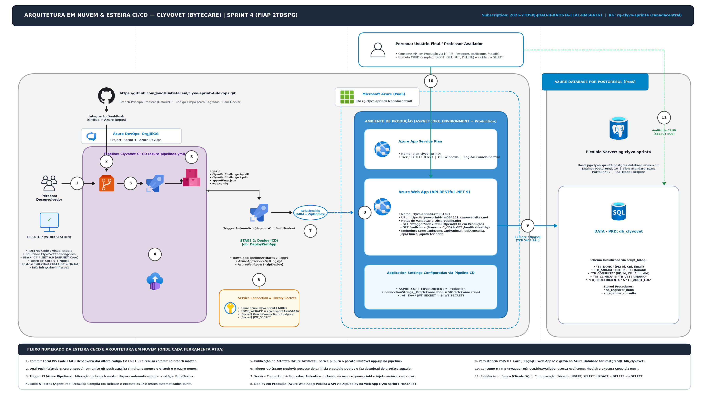

# ClyvoVet API — DevOps Tools & Cloud Computing (Sprint 4)

**Instituicao:** FIAP — Faculdade de Informatica e Administracao Paulista  
**Disciplina:** DevOps Tools & Cloud Computing — 4a Sprint (2026)  
**Turma:** 2TDSPG  

---

## 1. Integrantes do Grupo (Turma 2TDSPG)

| Nome Completo | RM | Turma |
| :--- | :---: | :---: |
| **Erik Naoki Miyasato** | 565771 | 2TDSPG |
| **Gustavo Arthur Carvalho Sartori** | 561650 | 2TDSPG |
| **Gutemberg Rocha Silva** | 562267 | 2TDSPG |
| **Joao Henrique Batista Leal** | 564361 | 2TDSPG |
| **Juliana da Silva Stigliani** | 561171 | 2TDSPG |

---

## 2. Links Oficiais da Entrega (Nuvem, Swagger, Health Check, Azure DevOps, GitHub e YouTube)

| Recurso | Descricao | URL Oficial |
| :--- | :--- | :--- |
| **URL Base (Azure Web App)** | Endpoint principal da API em producao (PaaS) | https://clyvo-sprint4-rm564361.azurewebsites.net |
| **Swagger UI (Producao)** | Console interativo OpenAPI 3.0 para execucao do CRUD completo | https://clyvo-sprint4-rm564361.azurewebsites.net/swagger/index.html |
| **Rota de Teste CI/CD (`/wellcome`)** | Endpoint publico de verificacao de deploy automatico da pipeline | https://clyvo-sprint4-rm564361.azurewebsites.net/wellcome |
| **Status de Versao (`/api/status`)** | Marcador JSON de versao, ambiente e status operacional | https://clyvo-sprint4-rm564361.azurewebsites.net/api/status |
| **Health Check (`/health`)** | Diagnostico em tempo real da API e conexao com o banco em nuvem | https://clyvo-sprint4-rm564361.azurewebsites.net/health |
| **Projeto no Azure DevOps** | Organizacao `OrgJJEGG` / Projeto `Sprint 4 - Azure DevOps` | https://dev.azure.com/OrgJJEGG/Sprint%204%20-%20Azure%20DevOps |
| **Repositorio GitHub (Entrega DevOps)** | Repositorio oficial na branch `master` com CI/CD e IaC | https://github.com/JoaoHBatistaLeal/clyvo-sprint-4-devops |
| **Repositorio GitHub (Codigo Fonte C#)** | Repositorio base da solucao em .NET | https://github.com/JoaoHBatistaLeal/clyvovet-csharp |
| **Video de Demonstracao (YouTube)** | Apresentacao tecnica da esteira CI/CD e CRUD em nuvem | https://youtu.be/MEtaddtCgEw |

---

## 3. Descricao da Solucao (ClyvoVet) e Beneficios para o Negocio

O **ClyvoVet** e uma plataforma corporativa e API RESTful desenvolvida em **.NET 9 (ASP.NET Core Web API)** voltada para a gestao clinica veterinaria integrada e o acompanhamento continuo da saude preventiva de animais de estimacao. A solucao foi arquitetada sob os principios de **Clean Architecture** e **SOLID**, integrando tutores (`Dono`), pacientes (`Animal`), unidades de atendimento (`Clinica`), corpo clinico (`Veterinario`), agendamentos e laudos (`Consulta`), prontuario (`Historico`), receituario (`Prescricao`), diario de sintomas (`Diario` e `Sintoma`) e triagem clinica assistida por Inteligencia Artificial.

### Beneficios Diretos para o Negocio e Operacao:
- **Eliminacao de Gargalos no Atendimento e Prontuario:** Centraliza o cadastro de tutores, pets, clinicas, veterinarios e consultas em um banco de dados relacional em nuvem na Terceira Forma Normal (3FN), evitando perda de historico clinico e conflitos de agendamento.
- **Automacao Completa de Entrega (CI/CD):** Qualquer evolucao de codigo enviada para a branch `master` aciona automaticamente a compilacao, a bateria de **140 testes automatizados** (xUnit + Moq + SQLite In-Memory), o empacotamento do artefato `app.zip` e a implantacao via ZipDeploy no Azure App Service sem intervencao manual.
- **Confiabilidade e Qualidade Asseguradas antes do Deploy:** O estagio de Continuous Delivery (`Deploy`) depende estritamente da aprovacao integral do estagio de Continuous Integration (`BuildTestes`), impedindo que regressoes de regra de negocio cheguem ao ambiente produtivo.
- **Governanca e Seguranca (DevSecOps):** Zero senhas, connection strings ou chaves JWT estao expostas no codigo-fonte (`appsettings.json`, `appsettings.Development.json` ou `azure-pipelines.yml`). Todos os segredos sao armazenados com criptografia e cadeado ativado nas Variaveis Secretas do Azure DevOps e injetados nas Application Settings do Azure Web App durante o deploy.
- **Escalabilidade em Nuvem (PaaS):** Hospedagem gerenciada no **Azure App Service (Web App Windows)** comunicando-se diretamente com o banco de dados relacional em nuvem no mesmo Resource Group (`rg-clyvo-sprint4`).

---

## 4. Stack Tecnologica

| Camada / Componente | Tecnologia Utilizada | Finalidade no Projeto |
| :--- | :--- | :--- |
| **Linguagem & Runtime** | C# 13 / .NET 9.0 SDK | Desenvolvimento da Web API RESTful em Clean Architecture |
| **Framework Web & ORM** | ASP.NET Core Web API + Entity Framework Core 9.0 | Exposicao de rotas REST, validacoes, Migrations automaticas e mapeamento Fluent API |
| **Testes Automatizados** | xUnit 2.9 + Moq 4.20 + WebApplicationFactory | Suite com 140 testes automatizados (104 unitarios e 36 de integracao) no padrao AAA |
| **Hospedagem PaaS (Compute)** | Azure App Service (`clyvo-sprint4-rm564361`) | Hospedagem gerenciada da API no App Service Plan `plan-clyvo-sprint4` (SKU F1 Windows) |
| **Banco de Dados em Nuvem** | Azure Database for PostgreSQL Flexible Server PaaS (`pg-clyvo-sprint4`) / Oracle FIAP | Persistencia relacional em nuvem (`db_clyvovet`) com tabelas CORE relacionadas e CRUD real |
| **Orquestracao CI/CD** | Azure DevOps Pipelines (`azure-pipelines.yml`) | Pipeline multi-stage em YAML com Build, Testes xUnit, Artifact `app` e Deploy automatico |
| **Controle de Versao** | GitHub + Azure Repos (Branch `master`) | Versionamento distribuido configurado com Dual-Push simultaneo na branch `master` |
| **Integracao Segura Azure** | Service Connection (`azure-clyvo-sprint4`) | Autenticacao Azure Resource Manager via Workload Identity Federation |
| **Infraestrutura como Codigo** | PowerShell + Azure CLI (`infra/criar-infra.ps1`) | Script versionado para provisionamento reprodutivel dos recursos no Azure |
| **Observabilidade & Docs** | Swagger / OpenAPI 3.0 + HealthChecks + Serilog + OpenTelemetry | Documentacao interativa em producao (`/swagger/index.html`) e monitoramento (`/health`) |

---

## 5. Diagrama da Arquitetura e Fluxo CI/CD Numerado



### Tabela Descritiva do Fluxo Integrado de Arquitetura e CI/CD (Passos 1 a 12):

| Passo | Etapa / Componente | Descricao Tecnica Detalhada |
| :---: | :--- | :--- |
| **1** | **Dev faz push na branch `master`** | O desenvolvedor realiza alteracoes no codigo C# .NET localmente, valida com `dotnet test` e executa `git push origin master`. |
| **2** | **Sincronizacao GitHub / Azure Repos** | O Git local configurado com Dual-Push envia os commits simultaneamente para o GitHub (`clyvo-sprint-4-devops`) e para o Azure Repos (`Sprint 4 - Azure DevOps`) na branch `master`. |
| **3** | **Trigger automatico do CI** | O Azure DevOps detecta o novo commit na branch `master` (ignorando alteracoes exclusivas em `README.md` ou `docs/*`) e inicia imediatamente o estagio `BuildTestes` (`CI - Build e Testes`). |
| **4** | **Restore & Build** | O agente executa `UseDotNet@2` (SDK `9.x`) seguido de `DotNetCoreCLI@2` para restaurar os pacotes NuGet (`restore`) e compilar a API em modo `Release` (`build --configuration Release`). |
| **5** | **Execucao de Testes xUnit** | A tarefa `DotNetCoreCLI@2` (`command: test`) executa os **140 testes automatizados** (`**/*Tests*.csproj`) e publica automaticamente o relatorio de resultados na aba **Tests** do Azure DevOps sob o titulo `Testes Automatizados ClyvoVet`. |
| **6** | **Empacotamento e publicacao do artefato `app.zip`** | Apos 100% de aprovacao nos testes, a pipeline executa `dotnet publish`, compacta os binarios com `ArchiveFiles@2` gerando `$(Build.ArtifactStagingDirectory)/app.zip` e publica o artefato `app` via `PublishPipelineArtifact@1`. |
| **7** | **Disparo automatico do CD** | Condicionado ao sucesso do estagio de CI (`dependsOn: BuildTestes` e `condition: succeeded()`), o estagio `Deploy` (`CD - Deploy no Azure App Service`) inicia automaticamente. |
| **8** | **Autenticacao via Service Connection `azure-clyvo-sprint4`** | O job `DeployWebApp` baixa o artefato `app` (`DownloadPipelineArtifact@2`) e autentica na assinatura `2026-2TDSPJ-JOAO-H-BATISTA-LEAL-RM564361` usando a Service Connection `azure-clyvo-sprint4`. |
| **9** | **Injecao de Variaveis Secretas nas App Settings** | A tarefa `AzureAppServiceSettings@1` injeta de forma segura no Web App `clyvo-sprint4-rm564361` as variaveis secretas da pipeline (`OracleConnection` / `DefaultConnection`, `JWT_SECRET` / `Jwt__Key` e `ASPNETCORE_ENVIRONMENT=Production`). |
| **10** | **Zip Deploy no Azure Web App** | A tarefa `AzureWebApp@1` realiza o deploy atomico (`deploymentMethod: zipDeploy`) do pacote `app.zip` para o Azure Web App `clyvo-sprint4-rm564361` no Resource Group `rg-clyvo-sprint4`. |
| **11** | **Consumo via HTTPS / Swagger pelo Usuario Final** | O usuario final ou avaliador acessa a aplicacao diretamente na nuvem via HTTPS (`/swagger/index.html`, `/wellcome`, `/health` e endpoints REST) sem qualquer dependencia de `localhost`. |
| **12** | **Persistencia no Banco em Nuvem** | O Azure Web App aplica automaticamente as Migrations do EF Core e executa todas as operacoes de CRUD (`INSERT`, `SELECT`, `UPDATE`, `DELETE`) diretamente no banco de dados relacional em nuvem (`db_clyvovet` em `pg-clyvo-sprint4.postgres.database.azure.com`). |

---

## 6. Estrutura do Banco de Dados em Nuvem (`script_bd.sql`)

O script DDL e DML completo encontra-se versionado na raiz do repositorio em [`script_bd.sql`](script_bd.sql) e em [`sql/script_bd.sql`](sql/script_bd.sql).

### Tabelas Relacionais Principais (3FN):
- **`TB_DONO` (Tabela Core 1 — Tutores):** Armazena os dados cadastrais dos tutores dos pets (`Id` PK UUID, `Nome`, `Cpf` Unique, `Email` Unique, `Telefone`, `DataNascimento`, `Endereco`, `CreatedAt`, `Active`).
- **`TB_ANIMAL` (Tabela Core 2 — Pets):** Armazena os pacientes vinculados obrigatoriamente a um tutor (`Id` PK UUID, `DonoId` FK referenciando `TB_DONO`, `Nome`, `Especie`, `Raca`, `Sexo`, `DataNascimento`, `Peso`, `CreatedAt`, `Active`).
- **`TB_CLINICA` (Unidades Veterinarias):** Cadastro das clinicas parceiras (`Id` PK, `Cnpj` Unique, `Email`, `Telefone`, `Endereco`, `HorarioFuncionamento`).
- **`TB_VETERINARIO` (Corpo Clinico):** Cadastro dos medicos veterinarios (`Id` PK, `Nome`, `Crmv` Unique, `Especialidade`, `Telefone`, `Email`).
- **`TB_CONSULTA` (Tabela Core 3 — Agendamentos e Atendimento Clinico):** Relaciona `TB_ANIMAL` (`AnimalId` FK), `TB_VETERINARIO` (`VeterinarioId` FK) e `TB_CLINICA` (`ClinicaId` FK), registrando data, hora, motivo, diagnostico, observacoes, tipo e status (`Agendada`, `Concluida`, `Cancelada`).
- **Tabelas Complementares de Prontuario:** `TB_HISTORICO`, `TB_PRESCRICAO`, `TB_DIARIO`, `TB_SINTOMA_CATALOGO` e `TB_DIARIO_SINTOMA`.

### Queries `SELECT` de Auditoria para Comprovacao do CRUD no Video:
```sql
SELECT "Id", "Nome", "Cpf", "Email", "Telefone", "DataNascimento", "Endereco", "CreatedAt", "Active"
FROM "TB_DONO"
ORDER BY "CreatedAt" DESC;

SELECT "Id", "DonoId", "Nome", "Especie", "Raca", "Sexo", "DataNascimento", "Peso", "CreatedAt", "Active"
FROM "TB_ANIMAL"
ORDER BY "CreatedAt" DESC;

SELECT "Id", "AnimalId", "VeterinarioId", "ClinicaId", "DataConsulta", "HoraConsulta", "Motivo", "Diagnostico", "Status", "Tipo"
FROM "TB_CONSULTA"
ORDER BY "CreatedAt" DESC;

SELECT a."Id" AS "AnimalId", a."Nome" AS "NomePet", a."Especie", a."Raca", a."Peso",
       d."Id" AS "TutorId", d."Nome" AS "NomeTutor", d."Cpf", d."Email"
FROM "TB_ANIMAL" a
INNER JOIN "TB_DONO" d ON a."DonoId" = d."Id"
ORDER BY a."CreatedAt" DESC;
```

---

## 7. Variaveis de Ambiente Protegidas (DevSecOps)

Em conformidade estrita com as regras da disciplina, **nenhuma senha, connection string ou segredo real consta nos arquivos de codigo ou configuracao** (`appsettings.json`, `appsettings.Development.json` ou `azure-pipelines.yml`). As variaveis sao configuradas na Pipeline do Azure DevOps e injetadas no Azure Web App pela task `AzureAppServiceSettings@1`:

| Nome da Variavel na Pipeline | Mapeamento no App Service (`appSettings`) | Tipo / Nivel de Protecao | Finalidade |
| :--- | :--- | :---: | :--- |
| `NOME_WEBAPP` | Parametro de destino (`clyvo-sprint4-rm564361`) | Visivel | Define o nome do Azure Web App alvo nas tasks de configuracao e ZipDeploy |
| `ASPNETCORE_ENVIRONMENT` | `ASPNETCORE_ENVIRONMENT` (`Production`) | Visivel | Define o ambiente de execucao do ASP.NET Core no Azure App Service |
| `OracleConnection` | `ConnectionStrings__OracleConnection` e `ConnectionStrings__DefaultConnection` | **Secret (Cadeado Ativado)** | String de conexao real com o banco de dados relacional em nuvem |
| `JWT_SECRET` | `JWT_SECRET` e `Jwt__Key` | **Secret (Cadeado Ativado)** | Chave simetrica de 256+ bits para assinatura e validacao de tokens JWT |

---

## 8. Como Executar Localmente e Rodar os Testes Automatizados

### Pre-requisitos:
- .NET 9.0 SDK instalado
- Git e Azure CLI (opcional, para provisionamento via `infra/criar-infra.ps1`)

### 1. Clonar o Repositorio (Branch `master`):
```powershell
git clone -b master https://github.com/JoaoHBatistaLeal/clyvo-sprint-4-devops.git
cd clyvo-sprint-4-devops
```

### 2. Restaurar Dependencias, Compilar e Executar os 140 Testes Automatizados:
Os testes unitarios (`ClyvoVetChallenge.Tests.Unit`) e de integracao (`ClyvoVetChallenge.Tests.Integration`) utilizam mocks (`Moq`) e banco em memoria (`SQLite`), executando de ponta a ponta sem exigir banco de dados externo:
```powershell
dotnet restore
dotnet build --configuration Release
dotnet test --configuration Release
```

### 3. Provisionar a Infraestrutura PaaS no Azure (Azure CLI):
```powershell
./infra/criar-infra.ps1
```

---

## 9. Estrutura de Diretorios do Repositorio

```text
clyvo-sprint-4-devops/
├── ClyvoVetChallenge.Api/                 Camada Web API RESTful (Controllers, Program.cs, Middlewares, HealthChecks, Swagger)
├── ClyvoVetChallenge.Application/         Camada de Aplicacao (Services, DTOs, Interfaces, Validacoes)
├── ClyvoVetChallenge.Domain/              Camada de Dominio (Entidades Core, Enums, Excecoes de Dominio)
├── ClyvoVetChallenge.Infrastructure/      Camada de Infraestrutura (EF Core AppDbContext, Migrations, Repositorios)
├── ClyvoVetChallenge.Tests.Unit/          104 Testes Unitarios (xUnit + Moq no padrao AAA)
├── ClyvoVetChallenge.Tests.Integration/   36 Testes de Integracao da API (WebApplicationFactory + SQLite isolado)
├── docs/
│   ├── arquitetura.png                    Diagrama da Arquitetura em Nuvem e Fluxo CI/CD numerado (1 a 12)
│   └── swagger.json                       Especificacao OpenAPI 3.0 exportada automaticamente pelos testes
├── infra/
│   └── criar-infra.ps1                    Script Azure CLI de provisionamento PaaS (RG, App Service Plan F1, Web App)
├── sql/
│   └── script_bd.sql                      Script DDL, carga inicial DML, Procedures e queries SELECT de auditoria
├── azure-pipelines.yml                    Pipeline oficial de CI/CD em YAML (Build, Testes xUnit, Artifact app e Deploy)
├── script_bd.sql                          Copia na raiz do script DDL/DML e queries SELECT do banco em nuvem
├── ENTREGA_PROJETO.md                     Documento executivo com dados oficiais dos integrantes e links de entrega
├── ClyvoVetChallenge.sln                  Solution oficial .NET 9
└── README.md                              Documentacao tecnica completa da Sprint 4
```
